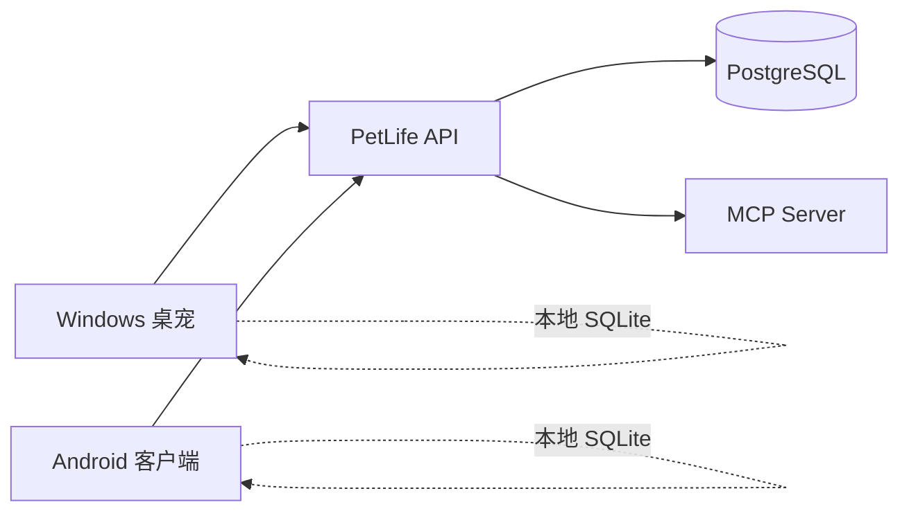

<div align="center">
  
  <h1>PetLife</h1>
  <p><strong>会陪伴你，也会帮你看见时间去了哪里的跨平台桌面宠物。</strong></p>
  <p>Windows 悬浮桌宠 · Android 悬浮窗 · 使用统计 · 多设备同步 · 自托管服务端</p>

  <p>
    <a href="https://github.com/aaa1789261750-png/DesktopPet/releases/tag/v0.1.0-preview.1"></a>
    
    
  </p>

  <p>
    <a href="#下载与安装">下载</a> ·
    <a href="#主要功能">功能</a> ·
    <a href="#从源码运行">开发</a> ·
    <a href="docs/README.md">文档</a> ·
    <a href="server/README.md">服务端</a>
  </p>
</div>

> [!IMPORTANT]
> PetLife 目前处于预发布阶段。Windows 版可直接解压运行；Android APK 暂用测试签名，未来切换正式签名时可能需要卸载旧预览版。

## PetLife 是什么？

PetLife 将桌宠、数字生活记录与多设备同步放在同一个应用里。桌宠可以显示在其他窗口之上，通过 P3P 风格轮盘完成互动和快捷操作；应用在本机记录前台应用与使用时段，并可通过自托管服务端在 Windows 与 Android 之间同步。

| 桌宠体验 | 时间记录 | 跨设备能力 |
| --- | --- | --- |
| 透明悬浮、拖拽、动画素材、角色与状态切换 | 应用时长、使用时间段、时间线、当前应用 | 账户、设备管理、离线队列、增量同步 |
| P3P 风格轮盘菜单与自定义主题 | 数据默认保存在本机，可随时暂停采集 | FastAPI + PostgreSQL + MCP Server |

## 下载与安装

前往 [PetLife v0.1.0-preview.1](https://github.com/aaa1789261750-png/DesktopPet/releases/tag/v0.1.0-preview.1) 下载适合你的版本。

| 平台 | 下载文件 | 使用方式 |
| --- | --- | --- |
| Windows 10/11 x64 | `PetLife-Windows-x64-v0.1.0-preview.1.zip` | 解压完整目录，运行 `petlife.exe`；不要只复制 EXE |
| Android | `PetLife-Android-v0.1.0-preview.1.apk` | 允许安装未知来源应用后安装；悬浮桌宠需手动授予悬浮窗权限 |
| Server | `PetLife-Server-v0.1.0-preview.1.zip` | 解压、配置 `.env`，然后使用 Docker Compose 部署 |

发布页同时提供 `SHA256SUMS.txt`。下载后可校验文件完整性：

```powershell
Get-FileHash .\PetLife-Windows-x64-v0.1.0-preview.1.zip -Algorithm SHA256
```

## 主要功能

- **悬浮桌宠**：Windows 与 Android 均支持置顶显示、拖动、角色切换和动态素材。
- **轮盘菜单**：支持点击、悬停与沿圆弧滑动，提供桌宠、形象、记录、工具和设置入口。
- **使用统计**：记录应用累计时长、具体使用时间段与时间线，可暂停并离线查看。
- **自动状态**：根据当前前台应用切换桌宠状态，并允许为每种状态指定素材。
- **素材管理**：导入单张、多张图片或素材包，管理作品包、角色和状态映射。
- **云端同步**：Windows 与 Android 共用账户和设备列表，增量上传、缓存与去重。
- **自托管后端**：FastAPI、PostgreSQL、Alembic、Docker Compose 和 MCP 数据接口。

## 系统架构



客户端在离线时继续写入本地数据库；登录并同步后，服务端按账户和设备隔离数据。服务端不会接收窗口标题、URL、文档名、截图或桌宠素材。

## 从源码运行

### 环境要求

| 目标 | 要求 |
| --- | --- |
| Flutter | stable 通道；Dart SDK `>=3.9.0 <4.0.0` |
| Windows | Windows 10/11 x64；Visual Studio 2022“使用 C++ 的桌面开发” |
| Android | Android SDK；JDK 17 |
| Server | Docker Compose，或 Python 3.12 + PostgreSQL 16 |

### 获取源码

```bash
git clone https://github.com/aaa1789261750-png/DesktopPet.git
cd DesktopPet
flutter pub get
```

### 运行客户端

```bash
# Windows
flutter run -d windows

# Android：先用 flutter devices 查看设备 ID
flutter run -d <device-id>
```

### 构建

```bash
flutter build windows --release
flutter build apk --release
```

> [!WARNING]
> 当前仓库的 Android `release` 构建仍使用测试签名。正式长期分发前必须配置并安全保存固定发布 keystore。

### 运行测试

```bash
flutter analyze
flutter test
```

### 启动服务端

```bash
cd server
cp .env.example .env
# 修改 .env 中的 JWT、数据库密码和部署地址
docker compose build
docker compose run --rm migrate
docker compose up -d
```

完整说明见 [`server/README.md`](server/README.md) 和 [`docs/16-服务端部署与配置.md`](docs/16-服务端部署与配置.md)。

## 仓库导航

| 目录 | 内容 |
| --- | --- |
| [`lib/`](lib/) | Flutter 主程序、共享业务、数据库、同步与界面 |
| [`android/`](android/) | Android Gradle 工程与 Kotlin 悬浮桌宠 |
| [`windows/`](windows/) | Windows Runner、CMake 与原生窗口桥接 |
| [`server/`](server/) | API、数据库迁移、同步服务、Docker 与 MCP Server |
| [`test/`](test/) | Dart、Widget、平台契约与回归测试 |
| [`docs/`](docs/) | 架构、协议、构建、隐私与阶段交付文档 |
| [`tools/`](tools/) | 开发、诊断、素材探测和资源生成脚本 |

## 数据与隐私

- 使用记录默认保存在设备本地，只有登录并触发同步后才上传。
- 用户可以暂停采集、断开账户或独立部署服务端。
- `.env`、签名文件、运行数据库和日志均被排除在版本库之外。
- 安全与隐私设计见 [`docs/19-隐私与安全说明.md`](docs/19-隐私与安全说明.md)。

## 项目状态

- Windows x64：核心桌宠、轮盘、统计与同步已可用。
- Android：客户端、使用统计与悬浮桌宠已可用。
- Server：账户、设备、统计、同步与 MCP 接口已可部署。
- 当前重点：正式签名、CI/CD、安装包、自动升级与发布流程。

## 参与开发

欢迎提交 Issue 和 Pull Request。修改窗口 Region、轮盘几何、同步协议或数据库迁移时，请同时补充对应测试与文档。

## 许可证

项目暂未指定开源许可证。在许可证确定前，代码公开可见不等于获得复制、修改或再分发授权。
